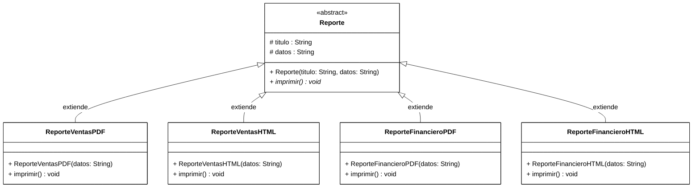
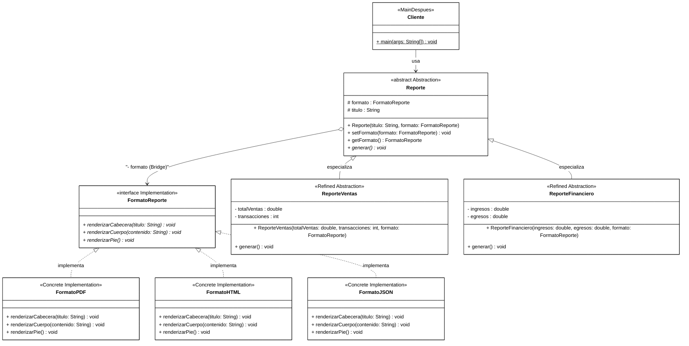

# Ejemplo Práctico del Patrón Bridge en Java (Sistema de Reportes)

Este proyecto está diseñado para **explicar en clase de manera clara y visual** el patrón de diseño estructural **Bridge**.

---

## 🎯 ¿Qué es el Patrón Bridge?
> *"Desacopla una abstracción de su implementación para que ambas puedan variar independientemente."* (Gang of Four)

En lugar de usar **herencia profunda**, el patrón Bridge utiliza **composición**. Convierte una relación `es-un` rígida en una relación `tiene-un` flexible mediante un **puente (referencia a interfaz)**.

---

## 📂 Estructura del Proyecto

```text
EjemploBridge/
├── bin/                          # Clases compiladas (.class)
├── src/
│   ├── antes/                    # CASO 1: Sin Bridge (Herencia tradicional rígida)
│   │   ├── Reporte.java
│   │   ├── ReporteVentasPDF.java
│   │   ├── ReporteVentasHTML.java
│   │   ├── ReporteFinancieroPDF.java
│   │   ├── ReporteFinancieroHTML.java
│   │   └── MainAntes.java
│   │
│   └── despues/                  # CASO 2: Con Patrón Bridge (Composición desacoplada)
│       ├── formato/              # [IMPLEMENTADOR]
│       │   ├── FormatoReporte.java   <-- Interfaz Puente (Implementor)
│       │   ├── FormatoPDF.java       <-- Implementación Concreta
│       │   ├── FormatoHTML.java      <-- Implementación Concreta
│       │   └── FormatoJSON.java      <-- Implementación Concreta
│       ├── reporte/              # [ABSTRACCIÓN]
│       │   ├── Reporte.java          <-- Abstracción base (tiene FormatoReporte)
│       │   ├── ReporteVentas.java    <-- Abstracción Refinada
│       │   └── ReporteFinanciero.java<-- Abstracción Refinada
│       └── MainDespues.java
└── README.md
```

---

## 🥊 Comparativa: Antes vs. Después

### 1. ANTES de aplicar Bridge (`src/antes`)
Intentamos manejar dos dimensiones (**Tipo de reporte** y **Formato de salida**) mediante herencia directa.



* **Problema:** Explosión combinatoria de clases ($M \times N$).
  - 2 reportes $\times$ 2 formatos = **4 clases**.
  - Si agregamos el formato **JSON** y el reporte **Inventario**: $3 \times 3 =$ **9 clases**.
  - No es posible cambiar el formato en tiempo de ejecución (acoplamiento estático en compilación).

---

### 2. DESPUÉS de aplicar Bridge (`src/despues`)
Estructura desacoplada idéntica al diagrama estándar del patrón Bridge:
- **Cliente:** [MainDespues](file:///c:/Users/herna/Desktop/EjemploBridge/src/despues/MainDespues.java)
- **Abstracción:** [Reporte](file:///c:/Users/herna/Desktop/EjemploBridge/src/despues/reporte/Reporte.java) y sus abstracciones refinadas ([ReporteVentas](file:///c:/Users/herna/Desktop/EjemploBridge/src/despues/reporte/ReporteVentas.java), [ReporteFinanciero](file:///c:/Users/herna/Desktop/EjemploBridge/src/despues/reporte/ReporteFinanciero.java))
- **Implementador:** [FormatoReporte](file:///c:/Users/herna/Desktop/EjemploBridge/src/despues/formato/FormatoReporte.java) y sus implementaciones concretas ([FormatoPDF](file:///c:/Users/herna/Desktop/EjemploBridge/src/despues/formato/FormatoPDF.java), [FormatoHTML](file:///c:/Users/herna/Desktop/EjemploBridge/src/despues/formato/FormatoHTML.java), [FormatoJSON](file:///c:/Users/herna/Desktop/EjemploBridge/src/despues/formato/FormatoJSON.java))
- **El Puente (*Bridge*):** Relación de composición `Reporte o--> FormatoReporte`



* **Solución:** Crecimiento lineal ($M + N$).
  - 2 reportes $+$ 3 formatos = **5 clases**.
  - Para soportar **JSON**, solo agregamos una clase (`FormatoJSON`) y automáticamente funciona para **todos** los tipos de reportes existentes.
  - ¡Podemos cambiar el formato dinámicamente con `reporte.setFormato(...)` sin recrear el objeto!

---

## 🚀 Compilación y Ejecución

Desde la carpeta raíz del proyecto (`EjemploBridge`):

### 1. Compilar todo a la carpeta `bin`
En PowerShell / CMD:
```bash
javac -d bin src/antes/*.java src/despues/formato/*.java src/despues/reporte/*.java src/despues/*.java
```

### 2. Ejecutar el caso "Antes"
```bash
java -cp bin antes.MainAntes
```

### 3. Ejecutar el caso "Después" (con Bridge)
```bash
java -cp bin despues.MainDespues
```

---

## 👨‍🏫 Guion Sugerido para Explicar en Clase

1. **Introducción del Problema (Caso Antes):**
   - Muestra `MainAntes.java`. Pregunta a los estudiantes: *"¿Qué pasa si mi jefe me pide exportar a formato Excel y agregar un reporte de Recursos Humanos?"*
   - Explica el concepto de **explosión de clases**: la herencia multiplica las clases ($M \times N$).

2. **La Solución (El Puente):**
   - Abre `despues/reporte/Reporte.java`. Señala el atributo `protected FormatoReporte formato;`. **Ese es el puente.**
   - Explica el principio: *"Favorecer la composición sobre la herencia"*.

3. **Demostración en Vivo:**
   - Ejecuta `MainDespues.java`.
   - Muestra cómo `ReporteVentas` se imprime en PDF, luego con una sola línea (`setFormato(html)`) cambia a HTML en tiempo de ejecución.
   - Resalta que `FormatoJSON` se creó una sola vez y sirvió para cualquier reporte sin tocar una sola línea de `ReporteVentas` ni `ReporteFinanciero`.
